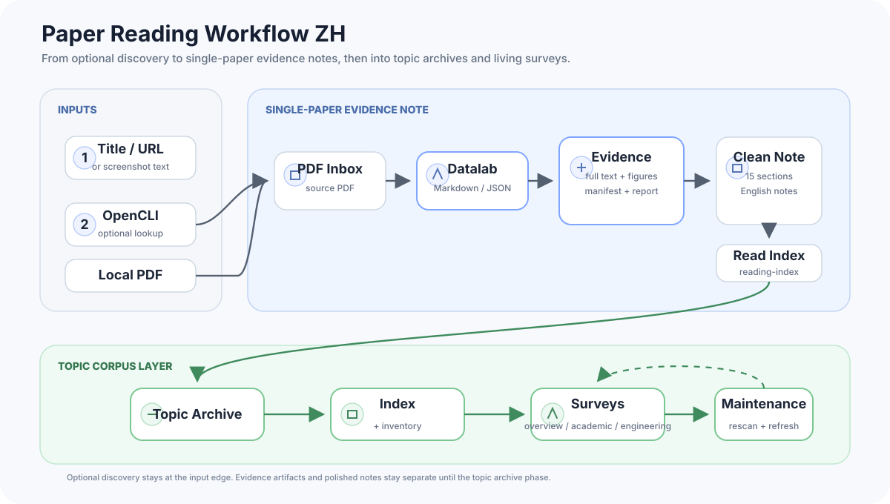

<div align="center">

[](README.md) &nbsp; [](README.zh-CN.md)

# Paper Reading Workflow ZH

### Local-first evidence workflows for paper notes, topic archives, and surveys

<p align="center">
  
  
  
  <a href="https://github.com/LeoLin990405/paper-reading-workflow-zh/actions/workflows/ci.yml"></a>
  
</p>

</div>

> Turn scattered PDFs into a living research corpus: source files, extraction evidence, readable English Obsidian notes, topic archives, and overview / academic / engineering surveys stay connected.

---

## Overview

Paper Reading Workflow packages a local paper-reading practice into reusable Codex Skills and Python helpers. It is designed for readers who do not want a disposable summary: every processed paper keeps a raw per-paper workspace, a clean English Obsidian note, and a path into a topic-level archive.

The workflow is intentionally split into two levels:

- **Single paper:** download or register a PDF, preflight appendices, extract text and selected visuals, keep all raw artifacts in one paper folder, and write a 15-section English note.
- **Topic corpus:** fold same-type papers into a topic archive, maintain an inventory, and refresh overview, academic, and engineering surveys.

Private paths and local service addresses are kept out of the repository. Real locations live in environment variables or `paper-notes.config.json`, which is ignored by git. Generated artifacts use one ASCII `raw/<paper-id>/` directory per paper.

## 1. What It Handles

| Layer | Output | Purpose |
|---|---|---|
| Paper inbox | PDFs and reading state | Keep source files and reading status explicit |
| Evidence workspace | Datalab/MinerU JSON/Markdown, figures, manifests | Preserve extraction and claim-level grounding |
| Formal note | 15-section English Obsidian note | Make the paper readable and reviewable |
| Raw workspace | One `raw/<paper-id>/` folder per paper | Keep extraction and pruning artifacts together |
| Topic archive | Notes, raw folders, index, inventory | Treat same-type papers as a corpus |
| Topic surveys | `全景综述`, `学术综述`, `工程综述` | Turn a corpus into reusable synthesis |

## 2. Workflow Map



```text
paper title / URL / PDF
  -> OpenCLI-assisted discovery
  -> PDF inbox
  -> appendix preflight
  -> Datalab or MinerU extraction
  -> raw/<paper-id>/ workspace
  -> selected visual manifest
  -> clean English Obsidian note
  -> reading index
  -> topic archive
  -> overview / academic / engineering surveys
  -> recurring maintenance
```

All Skills live in `skills/`. The single-paper Skill is `skills/evidence-grounded-paper-notes-zh/`; the topic-family Skills sit next to it.

## 3. Repository Layout

```text
.
├── skills/
│   ├── evidence-grounded-paper-notes-zh/
│   ├── paper-knowledge-family-zh/
│   ├── paper-topic-archive-zh/
│   ├── paper-topic-survey-zh/
│   └── paper-topic-maintenance-zh/
├── paper_notes/
│   ├── config.py
│   ├── download.py
│   ├── datalab_extract.py
│   ├── mineru_extract.py
│   ├── appendix.py
│   ├── naming.py
│   ├── figure_manifest.py
│   └── validate_notes.py
├── scripts/            # thin wrappers around paper_notes modules
├── tests/
├── examples/
│   ├── paper-notes.config.example.json
│   └── sample-vault/   # legacy Chinese example assets
├── images/
├── NOTICE.md
└── README.zh-CN.md
```

Everything an agent needs to run the workflow is in `skills/`; everything that decides where files land is in `paper_notes/config.py`.

## 4. Requirements

- Python 3.10+
- `curl`
- [OpenCLI](https://github.com/jackwener/OpenCLI), optional but recommended for paper discovery
- A Datalab API key or local [MinerU](https://github.com/opendatalab/MinerU) API for PDF extraction
- Poppler `pdftoppm` and `Pillow` only when cropping visual evidence:

```bash
python -m pip install ".[visual]"
```

## 5. Quick Start

Clone and install locally:

```bash
git clone https://github.com/LeoLin990405/paper-reading-workflow-zh.git
cd paper-reading-workflow-zh
python -m pip install -e .
# or: uv sync (the repo ships uv.lock)
```

Installing exposes `paper-notes-download`, `paper-notes-extract`, `paper-notes-extract-datalab`, `paper-notes-figures`, and `paper-notes-validate` as commands. The `python scripts/*.py` forms below also work straight from a clone without installing.

Create a private config:

```bash
cp examples/paper-notes.config.example.json paper-notes.config.json
```

Download or register a paper:

```bash
python scripts/download_paper_opencli.py \
  --query "Attention Is All You Need" \
  --config paper-notes.config.json
```

Extract PDFs with Datalab (default):

```bash
python scripts/datalab_batch_extract.py --config paper-notes.config.json
```

Use `--appendix-policy full` to disable appendix cutoff.

Build visual manifests:

```bash
python scripts/build_figure_manifest.py --config paper-notes.config.json
```

Validate formal notes:

```bash
# notes archived under a topic folder
python scripts/validate_clean_notes.py --config paper-notes.config.json \
  --notes-dir vault/notes/<topic> --vault-root vault

# notes sitting flat in the reading inbox
python scripts/validate_clean_notes.py --config paper-notes.config.json
```

`--vault-root` matters because `raw/<paper-id>/…` links are vault-root relative. Without it, a topic-folder run reports every PDF embed as missing.

## 6. Configuration

Use `paper-notes.config.json`, or set environment variables:

```bash
export PAPER_NOTES_PDF_INBOX="$HOME/Papers/inbox"
export PAPER_NOTES_READING_INBOX="$HOME/Documents/Obsidian/ResearchVault/reading"
export PAPER_NOTES_ARCHIVE_ROOT="$HOME/Documents/Obsidian/ResearchVault/notes"
export DATALAB_API_KEY="..."
export MINERU_LOCAL_URL="http://127.0.0.1:8010"
export PAPER_NOTES_APPENDIX_POLICY="auto"
# Optional one-based override:
# export PAPER_NOTES_APPENDIX_START_PAGE="18"
```

`examples/paper-notes.config.example.json` documents the same fields. Keep the real config local.

## 7. Skill Family

| Skill | Role |
|---|---|
| `evidence-grounded-paper-notes-zh` | Single-paper download, extraction, note writing, reading index |
| `paper-knowledge-family-zh` | Orchestrates the whole paper knowledge family |
| `paper-topic-archive-zh` | Folds same-type notes into topic archives |
| `paper-topic-survey-zh` | Maintains `全景综述`, `学术综述`, and `工程综述` |
| `paper-topic-maintenance-zh` | Keeps living corpora current after new papers arrive |

The core rule is:

```text
single-paper note -> topic archive -> survey refresh -> recurring maintenance
```

## 8. Note Contract

Formal Obsidian notes use a fixed 15-section structure:

```text
PDF Source
Reading Information
1. One-Sentence Overview
2. Paper Information
3. Research Question
4. Core Method
5. Key Figures and Tables
6. Experiments and Results
7. Equations and Technical Details
8. Core Concepts
9. Contributions and Deep Understanding
10. Limitations and Critique
11. Connections to Previously Read Papers
12. Implications for My Work
13. Model Details
```

Backend terms such as `Evidence`, `Inference`, `MinerU`, `full_text`, `paper_index`, and `evidence_cards` should stay out of the polished note body.

## 9. Development

```bash
python -m pip install -e ".[dev]"
ruff check paper_notes scripts tests
pytest
```

The lint rule set is pinned in `pyproject.toml`. Left unset, it follows whatever ruff resolves at install time, so CI goes red on upstream releases that have nothing to do with this code.

CI runs lint, bytecode compilation, and unit tests on Python 3.10 and 3.12.

## 10. Attribution

This project was iterated after studying [MoonKirito/evidence-grounded-paper-deep-read](https://github.com/MoonKirito/evidence-grounded-paper-deep-read), a paper-reading Skill released under the MIT License.

Thanks also to [OpenCLI](https://github.com/jackwener/OpenCLI) for adapter-style paper discovery and [MinerU](https://github.com/opendatalab/MinerU) for document-to-Markdown/JSON extraction.

See `NOTICE.md` for attribution details.

## 11. License

MIT. See `LICENSE`.
