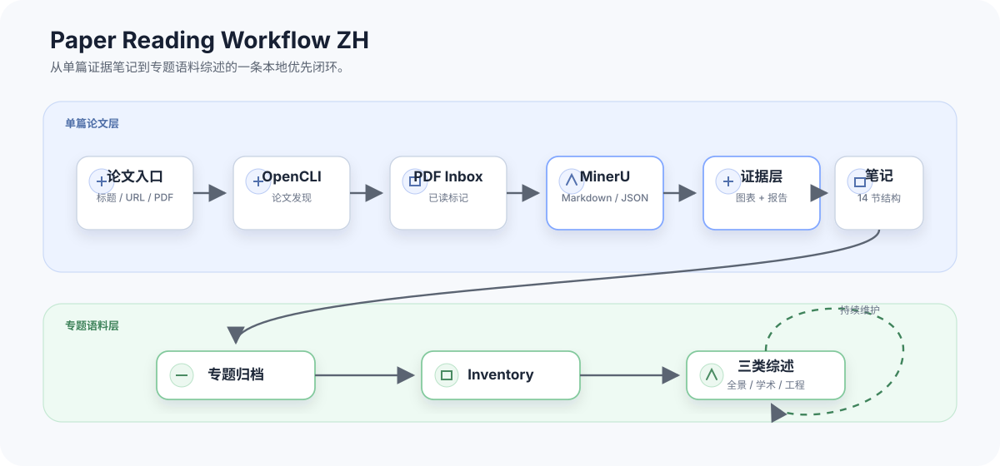

<div align="center">

[](README.md) &nbsp; [](README.zh-CN.md)

# Paper Reading Workflow ZH

### 面向论文笔记、专题归档和综述的本地优先证据工作流

<p align="center">
  
  
  
  <a href="https://github.com/LeoLin990405/paper-reading-workflow-zh/actions/workflows/ci.yml"></a>
  
</p>

</div>

> 把零散 PDF 变成一个活的研究语料库：源文件、抽取证据、可读的英文 Obsidian 笔记、专题归档，以及全景 / 学术 / 工程综述，彼此连起来。

---

## 概览

Paper Reading Workflow ZH 把一套本地读论文实践整理成可复用的 Skills 和 Python 辅助模块。它面向的不是一次性摘要：每篇处理过的论文都留着一个 raw 工作目录、一份干净的英文 Obsidian 笔记，以及通往专题语料库的路径。

工作流分两个层级：

- **单篇论文：** 获取或登记 PDF，先做附录预检，再抽取正文和选定图表，所有中间产物留在同一个论文目录里，最后写成 15 节英文笔记。
- **专题语料：** 把同类型论文并入 topic archive，维护 inventory，并刷新全景、学术和工程三份综述。

私有路径和本地服务地址不写进仓库。真实位置放在环境变量或 `paper-notes.config.json` 里，后者已被 git 忽略。生成物按 `raw/<paper-id>/` 一论文一目录存放，`paper-id` 只用 ASCII。

## 1. 处理对象

| 层级 | 产物 | 作用 |
|---|---|---|
| 论文 inbox | PDF 与阅读状态 | 让源文件和阅读状态显式存在 |
| 证据工作区 | Datalab / MinerU 的 JSON、Markdown、图表、manifest | 保留抽取结果和论点级证据 |
| 正式笔记 | 15 节英文 Obsidian 笔记 | 让论文可读、可复查 |
| Raw 工作区 | 一论文一个 `raw/<paper-id>/` | 抽取、切分、图表产物放在一起 |
| 专题归档 | 笔记、raw 目录、索引、inventory | 把同类型论文当成语料库 |
| 专题综述 | `全景综述`、`学术综述`、`工程综述` | 把语料库转成可复用的综合判断 |

## 2. 工作流地图



```text
论文标题 / URL / PDF
  -> OpenCLI 辅助发现
  -> PDF inbox
  -> 附录预检
  -> Datalab 或 MinerU 抽取
  -> raw/<paper-id>/ 工作目录
  -> 选定图表 manifest
  -> 干净的英文 Obsidian 笔记
  -> reading-index
  -> 专题归档
  -> 全景 / 学术 / 工程综述
  -> 持续维护
```

所有 Skill 都在 `skills/` 下：单篇论文主 Skill 是 `skills/evidence-grounded-paper-notes-zh/`，topic-family Skills 与之并列。

## 3. 仓库结构

```text
.
├── skills/
│   ├── evidence-grounded-paper-notes-zh/
│   ├── paper-knowledge-family-zh/
│   ├── paper-topic-archive-zh/
│   ├── paper-topic-survey-zh/
│   └── paper-topic-maintenance-zh/
├── paper_notes/
│   ├── config.py
│   ├── download.py
│   ├── datalab_extract.py
│   ├── mineru_extract.py
│   ├── appendix.py
│   ├── naming.py
│   ├── figure_manifest.py
│   └── validate_notes.py
├── scripts/            # paper_notes 模块的薄壳入口
├── tests/
├── examples/
│   ├── paper-notes.config.example.json
│   └── sample-vault/   # 旧版中文示例资产
├── images/
├── NOTICE.md
└── README.md
```

跑工作流需要的指令都在 `skills/`；决定文件落到哪里的逻辑都在 `paper_notes/config.py`。

## 4. 依赖

- Python 3.10+
- `curl`
- [OpenCLI](https://github.com/jackwener/OpenCLI)，用于论文发现，可选但推荐
- 用于 PDF 抽取的 Datalab API key，或本地 [MinerU](https://github.com/opendatalab/MinerU) API
- 只有裁图时才需要 Poppler `pdftoppm` 和 `Pillow`：

```bash
python -m pip install ".[visual]"
```

## 5. 快速开始

克隆并本地安装：

```bash
git clone https://github.com/LeoLin990405/paper-reading-workflow-zh.git
cd paper-reading-workflow-zh
python -m pip install -e .
# 或者：uv sync（仓库带 uv.lock）
```

安装后会得到 `paper-notes-download`、`paper-notes-extract`、`paper-notes-extract-datalab`、`paper-notes-figures`、`paper-notes-validate` 五个命令。下面的 `python scripts/*.py` 形式不安装也能直接用。

创建私有配置：

```bash
cp examples/paper-notes.config.example.json paper-notes.config.json
```

下载或登记论文：

```bash
python scripts/download_paper_opencli.py \
  --query "Attention Is All You Need" \
  --config paper-notes.config.json
```

用 Datalab 抽取 PDF（默认后端）：

```bash
python scripts/datalab_batch_extract.py --config paper-notes.config.json
```

`--appendix-policy full` 可以关掉附录截断。

生成图表清单：

```bash
python scripts/build_figure_manifest.py --config paper-notes.config.json
```

校验正式笔记：

```bash
# 笔记归档在 topic 目录下
python scripts/validate_clean_notes.py --config paper-notes.config.json \
  --notes-dir vault/notes/<topic> --vault-root vault

# 笔记平铺在 reading inbox 里
python scripts/validate_clean_notes.py --config paper-notes.config.json
```

`--vault-root` 是必需的上下文：`raw/<paper-id>/…` 是相对 vault 根解析的（Obsidian wikilink 本来就是全库解析）。topic 目录下不给这个参数，每一条 PDF 嵌入都会被判成缺失。

## 6. 配置

可以用 `paper-notes.config.json`，也可以设置环境变量：

```bash
export PAPER_NOTES_PDF_INBOX="$HOME/Papers/inbox"
export PAPER_NOTES_READING_INBOX="$HOME/Documents/Obsidian/ResearchVault/reading"
export PAPER_NOTES_ARCHIVE_ROOT="$HOME/Documents/Obsidian/ResearchVault/notes"
export DATALAB_API_KEY="..."
export MINERU_LOCAL_URL="http://127.0.0.1:8010"
export PAPER_NOTES_APPENDIX_POLICY="auto"
# 可选的一基页码覆盖：
# export PAPER_NOTES_APPENDIX_START_PAGE="18"
```

`examples/paper-notes.config.example.json` 记录了同一组字段。真实配置留在本地即可。

## 7. Skill Family

| Skill | 作用 |
|---|---|
| `evidence-grounded-paper-notes-zh` | 单篇论文的下载、抽取、写笔记 |
| `paper-knowledge-family-zh` | 编排整套论文知识流 |
| `paper-topic-archive-zh` | 把同类型论文收进专题归档 |
| `paper-topic-survey-zh` | 维护 `全景综述`、`学术综述` 和 `工程综述` |
| `paper-topic-maintenance-zh` | 新论文加入后保持专题语料持续更新 |

核心规则是：

```text
单篇笔记 -> 专题归档 -> 综述刷新 -> 持续维护
```

## 8. 笔记契约

正式 Obsidian 笔记使用固定 15 节结构：

```text
PDF Source
Reading Information
1. One-Sentence Overview
2. Paper Information
3. Research Question
4. Core Method
5. Key Figures and Tables
6. Experiments and Results
7. Equations and Technical Details
8. Core Concepts
9. Contributions and Deep Understanding
10. Limitations and Critique
11. Connections to Previously Read Papers
12. Implications for My Work
13. Model Details
```

第 5 节是全有或全无：标题里的 "Key" 会让人只放重点图，但校验器要求 manifest 里每一个 `selected: true` 且未标 `skip` 的条目都被嵌入。真要漏掉某项，就在 manifest 上给它标 `skip: true`，让计数和决定留在同一个地方。

`Evidence`、`Inference`、`MinerU`、`full_text`、`paper_index`、`evidence_cards` 等后端术语不应出现在 polished note 正文中。

## 9. 开发与测试

```bash
python -m pip install -e ".[dev]"
ruff check paper_notes scripts tests
pytest
```

lint 规则集在 `pyproject.toml` 里显式钉死；不写 `select` 的话规则集会跟着安装时的 ruff 版本漂移，CI 会因为跟自己代码无关的上游发版变红。

CI 在 Python 3.10 和 3.12 上跑 lint、字节码编译和单元测试。

## 10. 致谢

这个项目是在参考 [MoonKirito/evidence-grounded-paper-deep-read](https://github.com/MoonKirito/evidence-grounded-paper-deep-read) 之后继续迭代出来的；该项目是 MIT License 的 paper-reading Skill。

也感谢 [OpenCLI](https://github.com/jackwener/OpenCLI) 提供 adapter 式论文发现能力，以及 [MinerU](https://github.com/opendatalab/MinerU) 提供文档到 Markdown/JSON 的抽取能力。

更完整的来源说明见 `NOTICE.md`。

## 11. License

MIT。见 `LICENSE`。
