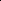

# Attention Is All You Need

## PDF 原文

![[pdfs/attention-is-all-you-need.pdf]]

> 本文件是仓库自带的示例笔记，用真实论文的骨架演示 14 节结构与校验规则。PDF 是占位文件，内容仅供演示。

## 已读信息

- 阅读时间：2026-07-13
- 阅读方式：示例数据，用于演示校验器

## 1. 一句话总览

这篇论文提出 Transformer：完全用自注意力替代循环和卷积结构，让序列建模可以整段并行训练，同时在机器翻译上拿到当时最好的结果。

## 2. 论文基本信息

- 标题：Attention Is All You Need
- 作者：Ashish Vaswani 等
- 发表：NeurIPS 2017
- arXiv 编号：1706.03762

## 3. 研究问题

循环网络按时间步串行计算，训练难以并行，长距离依赖也随路径长度衰减。论文要回答的问题是：能否只靠注意力机制构建序列转换模型，同时兼顾质量、并行度和训练成本。

## 4. 核心方法

模型由编码器和解码器各六层堆叠而成。每层的骨架是多头自注意力加逐位置前馈网络，配残差连接和层归一化；解码器再加一个对编码器输出的交叉注意力。位置信息用正弦位置编码注入，弥补注意力本身对顺序不敏感的缺陷。

## 5. 关键图表解读

### 图表 1：图 1

原文锚点：`Figure 1: The Transformer - model architecture.`

图表定位：这张图展示 Transformer 的编码器-解码器整体架构，重点看输入嵌入、位置编码、多头自注意力、前馈网络、残差连接与层归一化如何逐层串联。

读法：沿数据流从底部输入端读到顶部输出端，左侧为编码器栈，右侧为解码器栈；注意解码器一侧多出的掩码自注意力和交叉注意力两个模块。

可以支持的结论：模型确实不含任何循环或卷积模块，序列内的依赖全部由注意力承担。

不能推出：单张架构图不能说明训练效率和翻译质量，那些结论要看实验部分。

来源：第 3 页，原文编号：图 1。

## 6. 实验与结果

在 WMT 2014 英德和英法翻译上，大模型分别达到 28.4 和 41.8 BLEU，超过当时的最好结果，且训练成本明显低于此前的循环或卷积方案。消融显示多头数量、注意力键值维度和位置编码方式都会影响质量。

## 7. 公式与技术细节

缩放点积注意力是全文核心：

$$
\mathrm{Attention}(Q, K, V) = \mathrm{softmax}\!\left(\frac{QK^{\top}}{\sqrt{d_k}}\right)V
$$

除以 $\sqrt{d_k}$ 是为了防止内积随维度增大而进入 softmax 的饱和区；多头机制把 $Q, K, V$ 投影到多个子空间并行做注意力，再拼接投影回原维度。

## 8. 核心概念解释

- 自注意力：序列内部任意两个位置直接计算相关性，路径长度为常数；区别于循环结构中信息要按步传递。
- 多头注意力：多组独立投影让模型同时关注不同类型的关系，单头容易被平均效应抹平。
- 位置编码：注意力对输入顺序天然无感，正弦编码把绝对位置和相对位移信息以固定函数形式注入。

## 9. 创新点与深度理解

真正的创新不是注意力本身（此前已用于对齐），而是敢于把它当作唯一的信息混合机制，并用残差、层归一化和位置编码把纯注意力堆栈稳定住。常数路径长度改变了长距离依赖的学习难度，这是后续大模型可扩展性的根源。

## 10. 局限与批判

自注意力对序列长度是平方复杂度，长文档场景成本高；正弦位置编码在外推到远超训练长度时表现存疑；论文只验证了翻译和句法解析，泛化到其他模态靠的是后人工作而非本文证据。

## 11. 和已读论文的关系

本示例 vault 只有这一篇笔记，暂无交叉引用。真实语料中，这里应当用双链笔记连接同主题的已读论文，例如后续的预训练模型如何继承这套骨架。

## 12. 对我的启发

把"移除归纳偏置、换取并行度"当成一种可复用的设计决策：当某个串行结构成为扩展瓶颈时，先问它承担的功能能否用更并行的机制加约束来替代。
